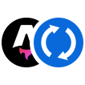
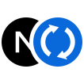

  <h1>google-docs-sync</h1>
   
  

    
  

   

[![Build Status][badge-build]][actions]
[![Coverage][badge-coverage]][codecov]
[![MIT license][badge-licence]](./LICENCE.md)
[![PRs welcome][badge-prs]](./CONTRIBUTING.md)
[![Sponsor][badge-sponsor]](#support-this-project)

---

Use Google Docs as a content source. This monorepo holds the packages that read a Google Doc, convert it to Markdown or MDX, and handle the Google authentication they need.

|                                       &nbsp;&nbsp;&nbsp;&nbsp;&nbsp;&nbsp;&nbsp;&nbsp;&nbsp;&nbsp;&nbsp;&nbsp;                                       | Package                   | Version                      | Downloads      | Use it for                    |
| :--------------------------------------------------------------------------------------------------------------------------------------------------: | ------------------------- | ---------------------------- | -------------- | ----------------------------- |
|        | [![][p-oauth]][d-oauth]   | [![npm][v-oauth]][n-oauth]   | ![][dl-oauth]  | OAuth helper                  |
|      | [![][p-md]][d-md]         | [![npm][v-md]][n-md]         | ![][dl-md]     | Markdown export               |
|                    | [![][p-sync]][d-sync]     | [![npm][v-sync]][n-sync]     | ![][dl-sync]   | Incremental sync, images, CLI |
|  | [![][p-gatsby]][d-gatsby] | [![npm][v-gatsby]][n-gatsby] | ![][dl-gatsby] | Gatsby site                   |
|    | [![][p-astro]][d-astro]   | [![npm][v-astro]][n-astro]   | ![][dl-astro]  | Astro site                    |
|                    | [![][p-next]][d-next]     | [![npm][v-next]][n-next]     | ![][dl-next]   | Next.js site                  |

## Support this project

  

  Hi, I'm <a href="https://cedricdelpoux.fr/en">Cédric</a>. 
  Between my three kids, I maintain <a href="https://github.com/cedricdelpoux?tab=repositories">open source projects</a> during my free time. 
  If my work is useful to you, a star, a one-time tip or a monthly sponsorship all help a lot. 
  Thank you very much!

  
  
  
  

[badge-build]: https://img.shields.io/github/actions/workflow/status/cedricdelpoux/google-docs-sync/ci.yml?branch=main&style=flat-square
[badge-coverage]: https://img.shields.io/codecov/c/github/cedricdelpoux/google-docs-sync/main.svg?style=flat-square
[badge-licence]: https://img.shields.io/badge/license-MIT-blue.svg?style=flat-square
[badge-prs]: https://img.shields.io/badge/PRs-welcome-brightgreen.svg?style=flat-square
[badge-sponsor]: https://img.shields.io/badge/sponsor-%E2%99%A5-ea4aaa.svg?style=flat-square
[actions]: https://github.com/cedricdelpoux/google-docs-sync/actions/workflows/ci.yml
[codecov]: https://app.codecov.io/gh/cedricdelpoux/google-docs-sync
[p-gatsby]: https://img.shields.io/static/v1?style=flat-square&label=%20&message=gatsby-source-google-docs&color=000605&logo=github&logoColor=white&labelColor=000605
[d-gatsby]: ./packages/gatsby-source-google-docs
[p-astro]: https://img.shields.io/static/v1?style=flat-square&label=%20&message=astro-loader-google-docs&color=000605&logo=github&logoColor=white&labelColor=000605
[d-astro]: ./packages/astro-loader-google-docs
[p-next]: https://img.shields.io/static/v1?style=flat-square&label=%20&message=next-google-docs&color=000605&logo=github&logoColor=white&labelColor=000605
[d-next]: ./packages/next-google-docs
[p-sync]: https://img.shields.io/static/v1?style=flat-square&label=%20&message=google-docs-sync&color=000605&logo=github&logoColor=white&labelColor=000605
[d-sync]: ./packages/google-docs-sync
[p-md]: https://img.shields.io/static/v1?style=flat-square&label=%20&message=google-docs-to-markdown&color=000605&logo=github&logoColor=white&labelColor=000605
[d-md]: ./packages/google-docs-to-markdown
[p-oauth]: https://img.shields.io/static/v1?style=flat-square&label=%20&message=google-oauth2-env-vars&color=000605&logo=github&logoColor=white&labelColor=000605
[d-oauth]: ./packages/google-oauth2-env-vars
[dl-gatsby]: https://img.shields.io/npm/dt/gatsby-source-google-docs.svg?style=flat-square&label=Downloads
[dl-astro]: https://img.shields.io/npm/dt/astro-loader-google-docs.svg?style=flat-square&label=Downloads
[dl-next]: https://img.shields.io/npm/dt/next-google-docs.svg?style=flat-square&label=Downloads
[dl-sync]: https://img.shields.io/npm/dt/google-docs-sync.svg?style=flat-square&label=Downloads
[dl-md]: https://img.shields.io/npm/dt/google-docs-to-markdown.svg?style=flat-square&label=Downloads
[dl-oauth]: https://img.shields.io/npm/dt/google-oauth2-env-vars.svg?style=flat-square&label=Downloads
[v-gatsby]: https://img.shields.io/npm/v/gatsby-source-google-docs.svg?style=flat-square
[n-gatsby]: https://www.npmjs.com/package/gatsby-source-google-docs
[v-astro]: https://img.shields.io/npm/v/astro-loader-google-docs.svg?style=flat-square
[n-astro]: https://www.npmjs.com/package/astro-loader-google-docs
[v-next]: https://img.shields.io/npm/v/next-google-docs.svg?style=flat-square
[n-next]: https://www.npmjs.com/package/next-google-docs
[v-sync]: https://img.shields.io/npm/v/google-docs-sync.svg?style=flat-square
[n-sync]: https://www.npmjs.com/package/google-docs-sync
[v-md]: https://img.shields.io/npm/v/google-docs-to-markdown.svg?style=flat-square
[n-md]: https://www.npmjs.com/package/google-docs-to-markdown
[v-oauth]: https://img.shields.io/npm/v/google-oauth2-env-vars.svg?style=flat-square
[n-oauth]: https://www.npmjs.com/package/google-oauth2-env-vars
