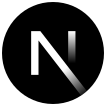

<div>
  <h1>google-docs-sync</h1>
  <br/>
  <p>
    
  </p>
  <br/>

[![Build Status][badge-build]][actions]
[![Coverage][badge-coverage]][codecov]
[![MIT license][badge-licence]](./LICENCE.md)
[![PRs welcome][badge-prs]](./CONTRIBUTING.md)
[![Sponsor][badge-sponsor]](#support)

</div>

---

Use Google Docs as a content source. This monorepo holds the packages that read a Google Doc, convert it to Markdown or MDX, and handle the Google authentication they need.

|                                                                      | Package                                                             | Version                      | Description                                                              |
| :------------------------------------------------------------------: | ------------------------------------------------------------------- | ---------------------------- | ------------------------------------------------------------------------ |
|    | [`gatsby-source-google-docs`](./packages/gatsby-source-google-docs) | [![npm][v-gatsby]][n-gatsby] | Gatsby plugin that uses Google Docs as a data source                     |
|     | [`astro-loader-google-docs`](./packages/astro-loader-google-docs)   | [![npm][v-astro]][n-astro]   | Astro content loader that uses Google Docs as a collection               |
|      | [`next-google-docs`](./packages/next-google-docs)                   | [![npm][v-next]][n-next]     | Next.js adapter that syncs Google Docs at build time                     |
|      | [`google-docs-sync`](./packages/google-docs-sync)                   | [![npm][v-sync]][n-sync]     | Sync a Google Drive folder of Google Docs to local Markdown or MDX files |
|  | [`google-docs-to-markdown`](./packages/google-docs-to-markdown)     | [![npm][v-md]][n-md]         | Convert a Google Docs API document to Markdown or MDX                    |
|       | [`google-oauth2-env-vars`](./packages/google-oauth2-env-vars)       | [![npm][v-oauth]][n-oauth]   | Generate and cache Google OAuth 2.0 tokens in `.env` files               |

## Which package do I need?

- **A Gatsby site**: [`gatsby-source-google-docs`](./packages/gatsby-source-google-docs).
- **An Astro site**: [`astro-loader-google-docs`](./packages/astro-loader-google-docs).
- **A Next.js site**: [`next-google-docs`](./packages/next-google-docs).
- **Another framework, a build script or the command line**: [`google-docs-sync`](./packages/google-docs-sync).

  ```shell
  npx google-docs-sync --folder <id>
  ```

  ```js
  import {syncGoogleDocs} from "google-docs-sync"

  const {documents} = await syncGoogleDocs({
    folder: "FOLDER_ID",
    outputDir: "src/content/docs",
  })
  ```

- **Only the conversion of a Google Docs API document**: [`google-docs-to-markdown`](./packages/google-docs-to-markdown).
- **Only Google OAuth tokens in `.env` files**: [`google-oauth2-env-vars`](./packages/google-oauth2-env-vars).

## How it works

The framework packages are thin adapters over `google-docs-sync`, which owns the Google APIs and the filesystem. Each package has its own README and CHANGELOG.

```text
gatsby-source-google-docs, astro-loader-google-docs, next-google-docs
  └─ google-docs-sync
       ├─ google-docs-to-markdown
       └─ google-oauth2-env-vars
```

## Support

<p align="center">
  <a href="https://github.com/cedricdelpoux"></a>
</p>

<p align="center">
  Hi, I'm <a href="https://github.com/cedricdelpoux">Cédric</a>. Between my three kids, I build and maintain this project and many other open source packages in my free time.<br>
  If my work is useful to you, a star or a small sponsorship helps a lot. Thank you!
</p>

<p align="center">
  <a href="https://thanks.dev/u/gh/cedricdelpoux"></a>
  <a href="https://github.com/sponsors/cedricdelpoux"></a>
  <a href="https://ko-fi.com/cedricdelpoux"></a>
  <a href="https://paypal.me/cedricdelpoux"></a>
</p>

[badge-build]: https://img.shields.io/github/actions/workflow/status/cedricdelpoux/google-docs-sync/ci.yml?branch=main&style=flat-square
[badge-coverage]: https://img.shields.io/codecov/c/github/cedricdelpoux/google-docs-sync/main.svg?style=flat-square
[badge-licence]: https://img.shields.io/badge/license-MIT-blue.svg?style=flat-square
[badge-prs]: https://img.shields.io/badge/PRs-welcome-brightgreen.svg?style=flat-square
[badge-sponsor]: https://img.shields.io/badge/sponsor-%E2%99%A5-ea4aaa.svg?style=flat-square
[actions]: https://github.com/cedricdelpoux/google-docs-sync/actions/workflows/ci.yml
[codecov]: https://app.codecov.io/gh/cedricdelpoux/google-docs-sync
[v-gatsby]: https://img.shields.io/npm/v/gatsby-source-google-docs.svg?style=flat-square
[n-gatsby]: https://www.npmjs.com/package/gatsby-source-google-docs
[v-astro]: https://img.shields.io/npm/v/astro-loader-google-docs.svg?style=flat-square
[n-astro]: https://www.npmjs.com/package/astro-loader-google-docs
[v-next]: https://img.shields.io/npm/v/next-google-docs.svg?style=flat-square
[n-next]: https://www.npmjs.com/package/next-google-docs
[v-sync]: https://img.shields.io/npm/v/google-docs-sync.svg?style=flat-square
[n-sync]: https://www.npmjs.com/package/google-docs-sync
[v-md]: https://img.shields.io/npm/v/google-docs-to-markdown.svg?style=flat-square
[n-md]: https://www.npmjs.com/package/google-docs-to-markdown
[v-oauth]: https://img.shields.io/npm/v/google-oauth2-env-vars.svg?style=flat-square
[n-oauth]: https://www.npmjs.com/package/google-oauth2-env-vars
