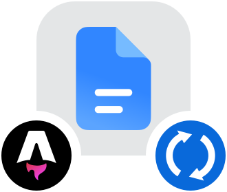

<div align="center">
  <h1>astro-loader-google-docs</h1>
  <br/>
  <p>
    
  </p>
  <br/>

[![Npm][badge-npm]][npm]
[![Build Status][badge-build]][actions]
[![Coverage][badge-coverage]][codecov]
[![Downloads][badge-downloads]][npm]
[![PRs welcome][badge-prs]][contributing]
[![MIT license][badge-licence]][licence]
[![Sponsor][badge-sponsor]][sponsor]

</div>

---

`astro-loader-google-docs` is an [Astro](https://astro.build/) [content loader](https://docs.astro.build/en/reference/content-loader-reference/) that uses [Google Docs](https://docs.google.com/) as a data source. It syncs a Google Drive folder with [google-docs-sync](https://github.com/cedricdelpoux/google-docs-sync/tree/main/packages/google-docs-sync) and stores one entry per document in a content collection.

## Features

- One collection entry per document, rendered with `render(entry)`
- Metadata validated by a Zod schema, the covers can be optimised images too
- Images optimised by Astro
- Incremental syncs: only the documents that changed are fetched and rendered again

## Installation

Requires **Node 22.12 or later** and **Astro 5 or later**.

```shell
npm install astro-loader-google-docs
```

The loader needs 3 variables (`GOOGLE_OAUTH_CLIENT_ID`, `GOOGLE_OAUTH_CLIENT_SECRET` and `GOOGLE_DOCS_TOKEN`) in the environment of the build. Astro does not put the `.env` file in `process.env`: load it in `astro.config.mjs` with `process.loadEnvFile()`. Generate them with `npx google-docs-sync-token`, see the [`google-docs-sync` documentation](https://github.com/cedricdelpoux/google-docs-sync/tree/main/packages/google-docs-sync#token-generation).

## Usage

Go to your [Google Drive](https://drive.google.com/drive/), create a folder and put some documents inside it. The folders tree gives the slugs and breadcrumbs, and the `description` of the folders and documents holds their YAML metadata: see [organize your documents](https://github.com/cedricdelpoux/google-docs-sync/tree/main/packages/google-docs-sync#organize-your-documents).

Add the loader to your collection in `src/content.config.ts`.

```ts
import {defineCollection} from "astro:content"
import {
  createGoogleDocsSchema,
  googleDocsLoader,
} from "astro-loader-google-docs"

const docs = defineCollection({
  loader: googleDocsLoader({
    // https://drive.google.com/drive/folders/FOLDER_ID
    folder: "FOLDER_ID",
  }),
  // Optional: makes the covers optimised images
  schema: ({image}) => createGoogleDocsSchema({image}),
})

export const collections = {docs}
```

Then render the documents like any other collection.

```astro
---
import {getCollection, render} from "astro:content"

const docs = await getCollection("docs")
const {Content} = await render(docs[0])
---

<h1>{docs[0].data.name}</h1>
<Content />
```

The [`examples/basic`](./examples/basic) site lists the documents of a Drive folder and renders each of them.

### Options

`googleDocsLoader(options)` takes the [options of `google-docs-sync`](https://github.com/cedricdelpoux/google-docs-sync/tree/main/packages/google-docs-sync#options) (`folder`, `outputDir`, `cacheDir`, `imagesOptions`, `debug`) and the [conversion options of `google-docs-to-markdown`](https://github.com/cedricdelpoux/google-docs-sync/tree/main/packages/google-docs-to-markdown#options), with the same names as in [gatsby-source-google-docs](https://github.com/cedricdelpoux/google-docs-sync/tree/main/packages/gatsby-source-google-docs). The `extension` is always `md`: the documents are rendered as Markdown, MDX is not supported.

`outputDir` and `cacheDir` are relative to the root of the Astro site. The loader owns `outputDir`: any other file it contains is deleted, so do not point it to a folder holding your own files. Add `outputDir` and `cacheDir` to your `.gitignore`.

### Entries

- The `id` of an entry is the path of its file under `outputDir`, without the extension: `index` for the root document, `guides/install` for a nested one.
- The `data` of an entry are the metadata of the document: `id`, `name`, `slug`, `path`, `date`, `createdTime`, `modifiedTime`, `breadcrumb`, `description`, `cover`, `related`, and the custom metadata of the Drive `description`.
- `createGoogleDocsSchema({image})` builds that schema. The loader declares it by default, so the schema of the collection is optional: define it to turn the covers into optimised images.

### Images

The images of the documents are written next to them in `outputDir`, and the Markdown refers to them with relative paths. The loader renders each document relative to its file, so Astro treats them like the images of local Markdown files: they are optimised and fingerprinted at build time. Nothing has to be copied to `public/`.

## Support

If this project is useful to you, you can give it a star, or support its maintenance:

<p align="center">
  <a href="https://thanks.dev/u/gh/cedricdelpoux"></a>
  <a href="https://github.com/sponsors/cedricdelpoux"></a>
  <a href="https://ko-fi.com/cedricdelpoux"></a>
  <a href="https://paypal.me/cedricdelpoux"></a>
</p>

[badge-npm]: https://img.shields.io/npm/v/astro-loader-google-docs.svg?style=flat-square
[badge-downloads]: https://img.shields.io/npm/dt/astro-loader-google-docs.svg?style=flat-square
[badge-build]: https://img.shields.io/github/actions/workflow/status/cedricdelpoux/google-docs-sync/ci.yml?branch=main&style=flat-square
[badge-coverage]: https://img.shields.io/codecov/c/github/cedricdelpoux/google-docs-sync/main.svg?flag=astro-loader-google-docs&style=flat-square
[badge-prs]: https://img.shields.io/badge/PRs-welcome-brightgreen.svg?style=flat-square
[badge-licence]: https://img.shields.io/badge/license-MIT-blue.svg?style=flat-square
[badge-sponsor]: https://img.shields.io/badge/sponsor-%E2%99%A5-ea4aaa.svg?style=flat-square
[npm]: https://www.npmjs.com/package/astro-loader-google-docs
[actions]: https://github.com/cedricdelpoux/google-docs-sync/actions/workflows/ci.yml
[codecov]: https://app.codecov.io/gh/cedricdelpoux/google-docs-sync/tree/main/packages/astro-loader-google-docs
[contributing]: https://github.com/cedricdelpoux/google-docs-sync/blob/main/CONTRIBUTING.md
[licence]: https://github.com/cedricdelpoux/google-docs-sync/blob/main/LICENCE.md
[sponsor]: #support
