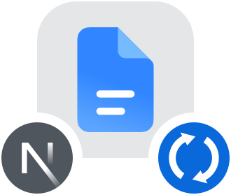

<div align="center">
  <h1>next-google-docs</h1>
  <br/>
  <p>
    
  </p>
  <br/>

[![Npm][badge-npm]][npm]
[![Build Status][badge-build]][actions]
[![MIT license][badge-licence]](./LICENCE.md)

</div>

---

`next-google-docs` is a [Next.js](https://nextjs.org/) integration to use [Google Docs](https://docs.google.com/) as a data source. It syncs a [Google Drive](https://drive.google.com/) folder to Markdown files and images when `next dev` or `next build` starts, and gives your App Router pages two functions to read them.

It is an adapter over [google-docs-sync](https://github.com/cedricdelpoux/google-docs-sync/tree/master/packages/google-docs-sync), which does the sync, and [google-docs-to-markdown](https://github.com/cedricdelpoux/google-docs-sync/tree/master/packages/google-docs-to-markdown), which does the conversion. How the Markdown is rendered is up to you.

## Installation

```shell
npm install next-google-docs
```

Next.js 14 or later is required, along with Node 22.12 or later.

## Token generation

The sync needs 3 variables, in a `.env` file that Next.js loads. Run the following command at the root of your project to generate them:

```shell
npx google-docs-sync-token
```

Add `.env` to your `.gitignore`: it holds secrets. Read the [google-docs-sync documentation](https://github.com/cedricdelpoux/google-docs-sync/tree/master/packages/google-docs-sync#token-generation) for the details.

## Usage

Wrap your Next.js config:

```js
// next.config.mjs
import {withGoogleDocs} from "next-google-docs"

export default withGoogleDocs(
  {/* your Next.js config */},
  {
    // https://drive.google.com/drive/folders/FOLDER_ID
    folder: "FOLDER_ID",
  }
)
```

The first argument can be an object or a config function, like the one Next.js accepts. It is returned as it is.

Read the documents from your pages, with the functions of `next-google-docs/documents`:

```jsx
// app/[...path]/page.jsx
import {notFound} from "next/navigation"
import {getDocument, getDocuments} from "next-google-docs/documents"

export const dynamicParams = false

export const generateStaticParams = async () =>
  (await getDocuments())
    .filter(({slug}) => slug !== "/")
    .map(({slug}) => ({path: slug.split("/").filter(Boolean)}))

export default async function Page({params}) {
  const document = await getDocument((await params).path)

  if (!document) {
    notFound()
  }

  // Render document.markdown with the tool you prefer
}
```

Add the synced folders to your `.gitignore`:

```gitignore
.google-docs
content/google-docs
public/google-docs
```

### Rendering

`document.markdown` is plain Markdown, without the frontmatter. Use any renderer, for example [next-mdx-remote](https://github.com/hashicorp/next-mdx-remote):

```jsx
import {MDXRemote} from "next-mdx-remote/rsc"
import remarkGfm from "remark-gfm"

;<MDXRemote
  source={document.markdown}
  options={{mdxOptions: {format: "md", remarkPlugins: [remarkGfm]}}}
/>
```

Set `extension: "mdx"` to author the documents as MDX.

## API

### `withGoogleDocs(nextConfig, options)`

Returns a Next.js config function. The options are the [google-docs-sync options](https://github.com/cedricdelpoux/google-docs-sync/tree/master/packages/google-docs-sync#options) (`folder`, `outputDir`, `cacheDir`, `extension`, `imagesOptions`, `auth`, `logger`, the converter options), plus:

| Option    | Required | Type   | Default               | Example          |
| --------- | -------- | ------ | --------------------- | ---------------- |
| folder    | `true`   | String | `null`                | `"1Tn1dCbIc"`    |
| outputDir | `false`  | String | `content/google-docs` | `"content/docs"` |
| publicDir | `false`  | String | `public/google-docs`  | `"public/docs"`  |

`publicDir` must be inside `public`. It is managed by the adapter, which empties it before every sync, so give it a directory of its own. `outputDir` is managed by google-docs-sync in the same way.

### `getDocuments(paths?)`

Returns the metadata of every synced document: `id`, `name`, `slug`, `path`, `breadcrumb`, `date`, `cover`, and your own metadata. The image of the `cover` is a URL.

### `getDocument(slug, paths?)`

Returns `{metadata, markdown}` for the document of a slug, or `null`. The slug is a string (`"/features/images"`) or the segments of a catch-all route (`["features", "images"]`), which is what `params.path` holds. The images of the Markdown are URLs served from `publicDir`.

Both functions read the files of `outputDir` and `publicDir` set in `withGoogleDocs`. Pass `{outputDir, publicDir}` as `paths` when they run somewhere the config was not loaded.

## How it works

- **When the sync runs**: once when `next dev` or `next build` starts, before any page is rendered. Next.js loads the config again in its workers, the adapter runs the sync only the first time. `next start` and the other commands do not sync: the documents are read from the build.
- **Caching**: the `.google-docs` folder keeps what was fetched, so the next syncs fetch only the documents that changed on Google Drive. Keep it between CI builds to make them faster.
- **`next dev`**: the documents are synced when the server starts. A change in Google Docs is visible after a restart, there is no live reload of the Drive folder.
- **Images**: they are written next to the documents in `outputDir`, then copied to `publicDir`, which Next.js serves from the root. The Markdown and the `cover` point to their URL (`/google-docs/images/...`). With `output: "standalone"`, copy `public` as Next.js asks.
- **Turbopack and webpack**: the sync runs in the config, which both bundlers load the same way. The page code imports only `next-google-docs/documents`, so the Google client is not part of your bundle.
- **Static output**: with `generateStaticParams`, every document is prerendered at build time. Pages are rendered from the files, no Google credentials are needed at runtime.

## Examples

[`examples/basic`](./examples/basic) is a minimal App Router site.

## Contributing

See the [contributing guide](https://github.com/cedricdelpoux/google-docs-sync#contributing) of the repository.

## Licence

[MIT](./LICENCE.md)

[npm]: https://www.npmjs.com/package/next-google-docs
[badge-npm]: https://img.shields.io/npm/v/next-google-docs.svg
[actions]: https://github.com/cedricdelpoux/google-docs-sync/actions
[badge-build]: https://github.com/cedricdelpoux/google-docs-sync/actions/workflows/ci.yml/badge.svg
[badge-licence]: https://img.shields.io/badge/licence-MIT-blue.svg
